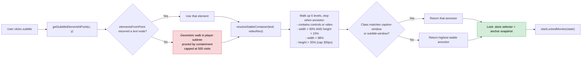
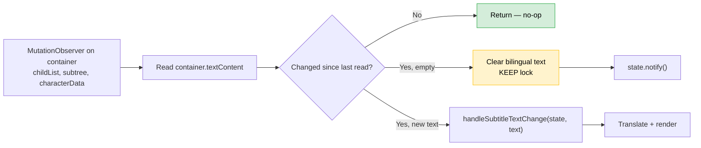
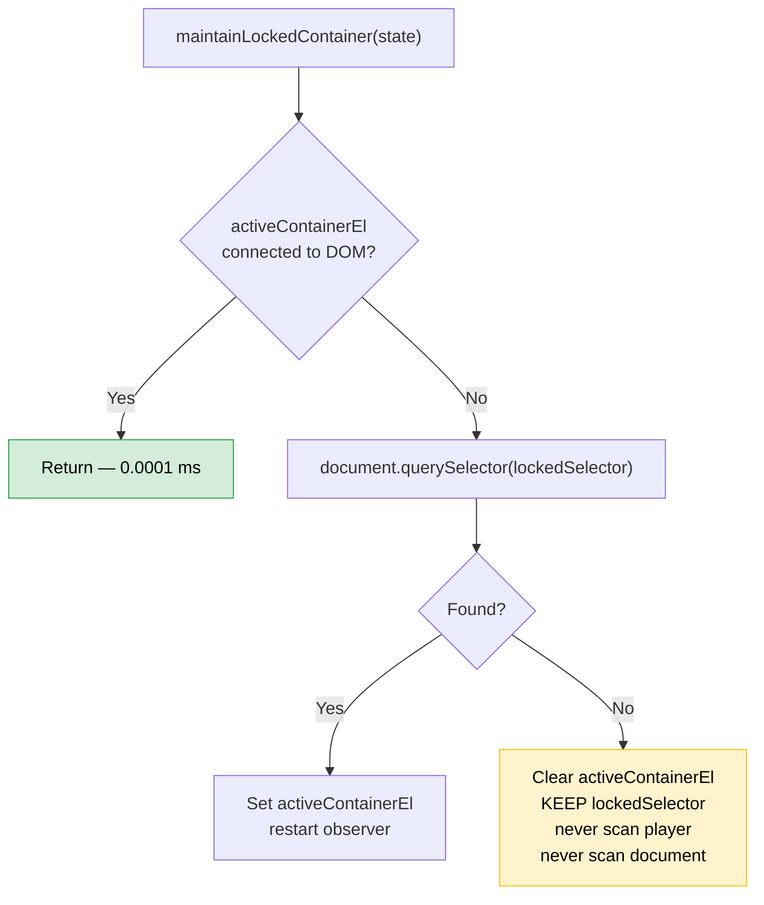

# AGENTS.md — SubAny Performance Contract

This file is a hard constraint on any change made to this codebase. Read it
before touching anything in `content/`, `utils/`, or `lib/`. If a change would
violate any invariant here, **stop and tell the user before implementing it.**

---

## The One Rule

**The extension must never force the browser to recompute layout on a hot path.**

"Hot path" means anything that runs more than once per cue change:

- `mousemove` / `pointermove` handlers
- `MutationObserver` callbacks
- `setInterval` / `setTimeout` callbacks
- `requestAnimationFrame` loops
- `video` media event handlers (`timeupdate`, `seeked`, `playing`, …)
- Anything called from the tracking tick
- Anything called from the auto-detect tick

Everything in this list is executed dozens to hundreds of times per second on
a large page (YouTube: 30,000–80,000 DOM nodes). If any of them causes a
forced synchronous layout, the page freezes. Not "feels slow" — freezes for
seconds at a time.

---

## What Causes Forced Layout (Forbidden)

Any of the following, when called on an element that is part of the *host
page's* DOM (not our own shadow-root overlay):

| API | Why it forces layout |
|---|---|
| `el.getBoundingClientRect()` | Reads geometry, flushes pending style/layout |
| `el.innerText` | Requires rendering to compute visible text |
| `window.getComputedStyle(el)` | Flushes style recalculation |
| `el.offsetWidth` / `offsetHeight` / `offsetTop` / `offsetLeft` | Geometry read |
| `el.scrollWidth` / `scrollHeight` / `scrollTop` | Geometry read |
| `document.elementsFromPoint()` | Hit-test, forces layout on dirty trees |

Calling any of these **once** is fine. Calling any of them in a loop over
many elements, or calling any of them repeatedly on a hot path, is a
performance bug that will freeze the page.

### Safe alternatives

| Instead of | Use |
|---|---|
| `el.innerText` | `el.textContent` (V8 string, zero reflow) |
| `getComputedStyle(el).pointerEvents` | `el.matches('[style*="pointer-events:none"]')` only if truly needed; prefer to not check |
| `elementsFromPoint` on every move | `elementsFromPoint` on click only |
| Repeated `getBoundingClientRect()` in a loop | Read once, cache in a variable, reuse |

---

## The Two Hot Paths and Their Rules

### 1. Tracking hot path (cue change → translation)

**Trigger:** `MutationObserver` on the locked caption container.

**Allowed work per cue change:**
- Read `container.textContent`
- Compare to previous text
- Call `handleSubtitleTextChange`

**Forbidden:**
- Any geometry read
- Any DOM walk outside the container
- Any search for a replacement container
- Any `querySelectorAll` on `document` or `document.body`
- Any call to `combineSubtitleLines`, `collectAutoSubtitleCandidates`,
  `getAllElements`, or `scoreSubtitleCandidate`

**Rationale:** The container persists across cues. There is nothing to
recover. If `document.contains(container)` is false, the lock is genuinely
gone — drop it and let the user re-lock. Do not search.

### 2. Auto-detect tick

**Trigger:** `setInterval` at ~280ms, running only when the mode is set to
`full-auto` or `replace-native`.

**Allowed work per tick:**
- Walk the video's player subtree using `textContent` as a free pre-filter
- Call `getBoundingClientRect` only on elements whose `textContent` already
  looks like a subtitle (2–400 chars, passes `isSubtitleText`)
- Cap the walk at 300 elements visited per video

**Forbidden:**
- Any class-name-based `querySelectorAll` that scans the whole document
- Walking `document.body` or `document.documentElement`
- Calling `getBoundingClientRect` on every element unconditionally
- Running when the mode is not `full-auto` / `replace-native`

---

## How the Current Architecture Works

### Selection (click → lock)

### Tracking (cue change → translation)

### Lock maintenance (only path that touches the DOM)

### Why the lock survives cue changes

Every browser-based subtitle player mounts a caption container **once** for
the whole video, and only replaces the text/children inside it as cues
change. If the container were destroyed and recreated on every cue, the user
would see the caption box flicker — background, padding, border, position —
on every sentence. No production player does this.

This is a universal invariant of subtitle rendering, not a YouTube-specific
fact. The architecture depends on it.

### Why we never scan for a replacement

Searching for the caption container costs time proportional to the size of
the search space. On YouTube, the player subtree is 500–2000 elements, and
every geometry read inside it forces a full-page layout. A "bounded" scan of
the player subtree still takes 3–6 seconds — enough to freeze the page. The
previous version of this codebase did exactly this and froze YouTube on
every cue change. Do not reintroduce it.

---

## If the User Asks You to Do Something That Would Violate This

Examples of prompts that are **performance regressions in disguise**:

- "Add recovery when the container is missing" → **No.** If the container is
  missing, drop the lock. Do not scan.
- "Show a preview highlight while hovering over subtitles" → **No** if it
  means running hit-testing on `mousemove`. Selection is click-only.
- "Score all candidates on the page to pick the best" → **No.** Scope the
  scoring to the video's player subtree, and only run it on the auto-detect
  tick, never on a pointer event.
- "Detect subtitles automatically" → **OK**, but only via the auto-detect
  tick with the geometric walk. Never on a hot path.
- "Improve accuracy by matching class names" → **OK as a preference, not a
  requirement.** The final decision must remain geometric.

If a prompt asks for one of the above:

1. **Do not implement it as asked.** Reply with what the prompt would break
   and why.
2. Offer the version of the change that respects the invariant.
3. If the user insists, warn them explicitly: *"This will freeze large
   pages. Confirm you want to proceed."*

---

## Absolute Invariants

These have all been violated at some point in this project's history. Each
violation was a multi-day debugging session. Do not repeat them.

1. **Never call `getAllElements(document)`.** Ever. It walks 30k–80k nodes
   and is the single worst offender in the codebase's history.

2. **Never call `getBoundingClientRect` in a loop over an unbounded set.**
   If you need geometry for N elements, N must be small (< ~100) or the
   loop must be pruned by containment first.

3. **Never use `innerText`.** Use `textContent`. `innerText` forces layout;
   `textContent` does not.

4. **Never attach a `MutationObserver` to `document.body`.** Attach it to
   the specific container you care about. On YouTube, `document.body`
   mutates constantly (player chrome, comments, feed updates).

5. **Never run a `requestAnimationFrame` loop in a React component.** Position
   overlays from event-driven triggers (prop change, `ResizeObserver`,
   `MutationObserver`, `scroll`, `resize`), never from a per-frame timer.

6. **Never use `setInterval` faster than 250ms on a hot path.** The only
   interval in this codebase is the auto-detect tick at ~280ms, and it
   only runs when auto mode is active.

7. **Never scan for a replacement container.** If the container is gone,
   the lock is gone. `querySelector(selector)` is the only allowed recovery,
   and only when the container was already disconnected.

8. **Never attach hit-testing to `mousemove`.** Selection is click-only.
   Hover highlighting that runs on `mousemove` is banned.

9. **Never store `innerText` snapshots.** Use `textContent` in anchors,
   text hints, and comparisons.

10. **Never generate selectors from IDs containing digits.** YouTube's
    caption windows are `#caption-window-1`, `#caption-window-2`, etc. The
    number changes when the player rebuilds; the selector dies. Use class
    names or attribute selectors instead.

---

## Before You Commit Any Change

Answer these:

- [ ] Does any code I added call `getBoundingClientRect`, `innerText`, or
      `getComputedStyle` in a loop?
- [ ] Does any code I added run on a `mousemove`, `MutationObserver`,
      `setInterval`, or `requestAnimationFrame` hot path?
- [ ] Does any code I added walk `document.body`, `document.documentElement`,
      or the full player subtree unconditionally?
- [ ] Does any code I added try to recover the lock by scanning?
- [ ] Does any code I added use class names as the primary signal, rather
      than as a preference on top of geometry?

If the answer to any of these is yes, revert and try again.

---

## Testing Protocol

Before claiming a performance fix works:

1. Open YouTube on a video with captions.
2. Open DevTools → Performance. Start recording.
3. Play the video for 30 seconds. Let at least 5 cues pass.
4. Stop recording.
5. Look at the flame graph for the caption-change moments:
   - No bar should be wider than 50ms.
   - No `[unattributed]` bucket should exceed 30% of total time.
   - `Recalculate Style` and `Layout` should be < 5% combined.
6. Grep the console for `[SubAny]` timing logs, if present. Every entry
   should be under 20ms. If any single entry exceeds 100ms, that's the bug.

"I tested it and it feels faster" is not evidence. The Performance panel
either shows the fix or it doesn't.

---

## Notes on Universality

The extension is universal because it uses **geometry**, not class names,
to find the caption container. Any site that renders subtitles into the DOM
produces a container with the same structural properties:

- It contains the caption text as a descendant.
- It stays mounted across cue changes.
- It's positioned in the lower portion of the video.
- It's small relative to the video (never more than ~30% of video height).
- It does not contain buttons, sliders, or the `<video>` element itself.

The geometry walk in `resolveStableContainer` and `getSubtitleElementAtPoint`
relies on exactly these properties. If a site breaks one of them, that site
is not DOM-renderable and no DOM approach will work — neither the current
code nor any previous version.

The only hardcoded class-name pattern is the `caption-window` preference in
`resolveStableContainer`. It's a preference, not a requirement: if it
doesn't match, the geometric fallback runs and produces the same result.

Sites that render subtitles into `<canvas>` with no DOM element cannot be
handled by this extension. That's a known limitation, not a bug.

---

### Class names in the codebase

Class names are allowed in exactly three roles:

1. Browser standard enums (TextTrack.kind === 'subtitles'). Not site-specific.
2. Preferences once a candidate has been found geometrically. If they don't
   match, the geometric path runs anyway and produces the same result.
3. Selector generation for the lock, where a stable class is preferred over
   a positional path.

Class names are FORBIDDEN as a discovery mechanism. `querySelectorAll('[class*="caption"]')`
must never be the way you find a subtitle. If you're adding a new discovery
path, it must be geometric.

## When in Doubt

If you're about to write code that touches the DOM in a way you're not
sure about, ask the user:

> "This change will call X on Y elements per Z event. That's N calls per
> second on a large page. Is that within the performance budget?"

The user can answer. Don't guess.